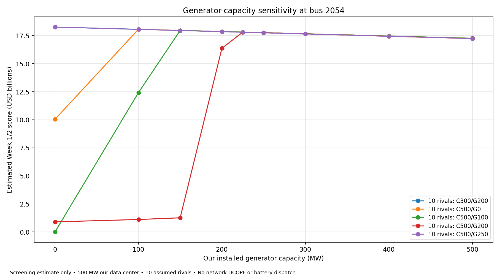
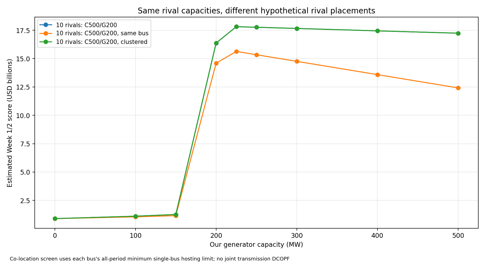

# Generator-only competition study (Week 1 Submission 1)

**Status:** preliminary screening; NOT a course DCOPF or official score. Independent 11-team submission cases are prepared for the official solver but have **not been run**.

## What was tested

- **630 combinations:** 7 candidate buses × 9 generation sizes × 10 rival strategies, 10 assumed opponent teams per case.
- Our requested data-center connection is **500 MW** at one bus (except the separately prepared split-site official case). Storage at our site is zero.
- Opponents include 300 MW/200 MW, 500 MW/0 MW, 500 MW/100 MW, 500 MW/200 MW, 500 MW/250 MW, 500 MW/300 MW, mixed, and concentrated-placement configurations.
- Candidate buses: 2054, 6141, 6062, 6298, 7414, 3048, 7346.

## First and most important observation

The representative-day peak has only **3,024.604 MW** of system nameplate generation headroom at period 109. This is **not** the same as network hosting capacity at any bus.

**C and G are not additive connection capacity.** If a rival chooses C=300 MW and G=200 MW, that rival requests **300 MW** of data-center load and its minimum possible grid demand (at full private generation) is 100 MW. C=500 MW and G=200 MW instead means a 500 MW load with minimum grid demand 300 MW.

For 11 teams each with C=500 MW and G=200 MW, minimum grid withdrawal is 11 × 300 = **3,300 MW**, exceeding the 3,024.604 MW aggregate peak headroom by **275.396 MW**. Joint curtailment or more privately supplied generation is unavoidable at this peak in the aggregate screen. If all 11 instead had C=500 MW and G=250 MW, minimum aggregate grid withdrawal would be 2,750 MW.

## Example: our bus 2054, best generator by assumed rival strategy

| Rival scenario | Best tested G (MW) | Our allocated fraction (screen) | Our Week 1/2 score (screen, $B) |
|---|---:|---:|---:|
| 10 rivals: C300/G200 | 0 | 100.0% | 18.26 |
| 10 rivals: C500/G0 | 100 | 100.0% | 18.06 |
| 10 rivals: C500/G100 | 150 | 100.0% | 17.96 |
| 10 rivals: C500/G200 | 225 | 100.0% | 17.81 |
| 10 rivals: C500/G250 | 0 | 100.0% | 18.26 |
| 10 rivals: C500/G200, same bus | 225 | 100.0% | 15.63 |
| 10 rivals: C500/G200, clustered | 225 | 100.0% | 17.81 |

Results are driven mainly by the **allocation incentive**: an on-site generator can help the operator allocate more of our 500 MW site when rival requests collectively exceed grid headroom. Higher generator capacity also increases capital costs, even if it is unused. **Do not choose these as final capacities without an official network-aware run.**





## Network-location limitations

The screen imposes the shared total-generation headroom and a conservative **minimum individual hosting capacity** for the aggregate load connected at each bus. It **does not** simulate Kirchhoff/DC flows, transmission limits shared across different buses, base-generation redispatch, nodal LMPs, or exact time-coupled storage.

Consequently, the diverse-opponent cases can give almost identical screened results across buses. **That is a limitation of the screening model, not evidence that locations are interchangeable.** Exact joint DCOPF comparison is particularly important for 6141 vs 2054, the line-constrained buses 6062/6298/7414, and the high-connectivity but lower-HC bus 7346.

The local hosting-capacity ceiling is applied conservatively to all representative periods for an illustrative screening dispatch. Actual per-hour hosting limits may be less restrictive outside the peak, so operating-cost estimates for heavy co-location can be understated or overstated by omitted network interactions.

## Scoring scope

This study computes a **Week 1 / Week 2 style** 10-year present-value estimate: IT value − allocated site capital − allocated generator capital − incremental generator fuel using the documented $80/$150/$250 MWh segments and the official period weights. It assumes grid energy purchases are free. Week 3 **cannot** be evaluated here: network LMPs from the joint DCOPF are necessary.

The model allocates site fractions by maximizing total served nameplate load under approximate capacity constraints, then applying the weighted quadratic fairness tie-break. It dispatches private generation at minimum cost subject to aggregate supply and conservative bus constraints. There are no batteries in the screen.

## Official-verification work queue

The **22** independent course-format 11-team cases in `official_cases/` have NOT been evaluated. They include:

- Generator sensitivity from G=0 through 300 MW against ten 500 MW/200 MW rivals.
- Comparative locations 2054, 6141, 6062, 6298, 7414, 3048 and 7346.
- Distributed, clustered and co-located rival siting assumptions.
- Battery-only opponents with P=196 MW, B=784 MWh; and a five-battery/five-generator rival mixture (both **official-only**, no screen score).
- A split-site control at buses 2054 and 6141.

**Priority official cases:** start with 05–09 (the generator threshold), 11–16 (bus sensitivity), 17–19 (competition sensitivity), then 20–21 (battery competitors).

Run one case at a time using the commands in `run_official_cases.sh`, from the **team repository root**. `ercot-game-batch` requires `highspy` and the full course dependencies. Do not infer anything about the results until the course evaluator has produced them.

## GitHub layout and reproduction

Copy this entire folder to `analysis/generator_competition_500mw/` inside your team repository. Keep the separate `ercot-connection-game/` subtree unchanged.

To reproduce this screening (Python 3.11+, numpy, pandas, scipy installed):

```bash
python analysis/generator_competition_500mw/run_generator_screen.py --repo-root . --out analysis/generator_competition_500mw
```

To rebuild the official CSV templates:

```bash
python analysis/generator_competition_500mw/make_official_cases.py --out analysis/generator_competition_500mw
```

To validate one candidate:

```bash
ercot-game-check-csv --file analysis/generator_competition_500mw/official_cases/07_rivals_C500G200_oursG225/submissions/our-team.csv --artifact-dir ercot-connection-game/data/processed/activsg2000_representative_v1
```

To run that scenario via the **course model** (from team repository root):

```bash
ercot-game-batch run --submissions-dir analysis/generator_competition_500mw/official_cases/07_rivals_C500G200_oursG225/submissions --artifact-dir ercot-connection-game/data/processed/activsg2000_representative_v1 --rules configs/scoring/dispatch_scoring_rules_500mw.json --week 1 --submission-number 1 --workers 4 --solver-backend auto --output-mode compact --output-dir analysis/generator_competition_500mw/official_cases/07_rivals_C500G200_oursG225/results
```

This writes official-model output into `results/` only when successfully run; it **does not** upload a class submission.

## Files

- `screen_results.csv`: all 630 screening results, one scenario per row; every score and allocation clearly labeled `_screen`.
- `best_per_bus_policy.csv`: one top-sized generator per bus × rival policy.
- `period_headroom.csv`: all 120 period headrooms calculated from the uploaded network.
- `screen_manifest.json`: sources, hashes, assumptions and counts.
- `official_case_index.csv`: 22 unrun official cases.
- `official_cases/`: canonical seven-column student CSVs for each of 11 hypothetical teams.
- `run_official_cases.sh`: full course evaluator commands for selected cases.
- `generator_sweep_bus2054.png`, `opponent_placement_sensitivity.png`, `peak_day_headroom.png`: explanatory plots.
- `run_generator_screen.py`, `make_official_cases.py`, `write_report.py`: reproducible scripts.

## Future work

Cross-check single-site screening against full 120-period official batch, include rival P=196 MW/B=784 MWh battery cases with exact daily state-of-charge constraints, repeat selected scenarios in Week 3 with LMP settlement, vary competitor bus allocations based on real Week 1 observations, and assess portfolio diversification. All opponent plans here are **hypothetical**, not inferred actual class submissions.

## Provenance

- Uploaded team ZIP snapshot dated November 19, 2026 (`ece51032-ercot-team-main.zip`).
- Scenario: `ercot-connection-game/data/processed/activsg2000_representative_v1/`.
- Rules: `configs/scoring/dispatch_scoring_rules_500mw.json`.
- Screening HC input: `analysis/carter_week1_material/hosting_capacity_all_buses.csv`.
- The instructor evaluator was **not** run here: the `highspy` Python dependency is missing from this environment. It is an explicit blocker rather than a validated competition result.
