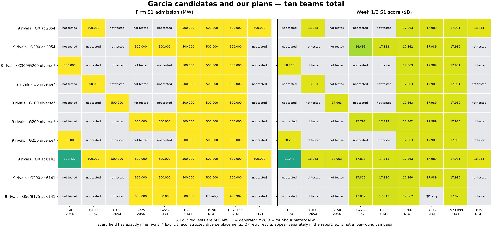

# Garcia candidates in the ten team game

Prepared November 21, 2026. **Ten teams total: our team plus nine rivals.** Every result below uses that team count and a 500 MW request from our team in Submission 1. Garcia’s uploaded study assumed eleven teams; his hardware choices are tested here with the actual nine opponents. Eleven-team explorations are excluded from this comparison.

**Execution:** 49 of 50 targeted pairs completed with the unchanged course evaluator. 1 more completed using an alternate fairness QP backend, reported separately. 0 targeted pairs remain unresolved. All completed evaluations cover the full 120-period horizon. These are **S1 results**, not four-round campaign totals.

## Findings for the actual ten team field

Against nine rivals with 200 MW generation at bus 6141, Garcia’s 225 MW generator at bus 2054 and all three of our benchmark plans received **500 MW**. The 225 MW build adds no admission benefit in this field. Our 200 MW generator improves the Week 1/2 S1 score by **$47.725M**, the refined 97 MW generator / 99 MW battery hybrid by **$117.506M**, and the 196 MW battery by **$176.536M**. Battery-only results in this field do not establish robustness against rivals with storage.

Against nine rivals with 50 MW generation and 175 MW / 700 MWh batteries, our refined hybrid retains **499.901525 MW**, meeting the earlier 499.9 MW target, and scores **$114.205M more** in W1/2 S1 than Garcia’s 225 MW generator, which retains exactly 500 MW. This supports the earlier hybrid finding within these matched fields; it does not prove a global optimum.

Against nine grid-only rivals, Garcia’s 100 MW generator and our earlier 35 MW / 140 MWh battery both retain the full 500 MW. The battery costs $49M versus $200M for the generator and improves the Week 1/2 S1 score by **$151.110M**. The small battery is a field-specific control, not a replacement for the refined hybrid across the wider rival set.

## Garcia hardware choices with nine opponents

| Each rival’s load and generation MW | Our generation MW at 2054 | Our admission MW | W1/2 S1 score $B | W3 S1 score $B |
| --- | --- | --- | --- | --- |
| C300 / G200 | 0 | 500.000000 | 18.263287 | 17.702258 |
| C500 / G0 | 100 | 500.000000 | 18.063177 | 17.502299 |
| C500 / G100 | 150 | 500.000000 | 17.962764 | 17.393428 |
| C500 / G200 | 225 | 500.000000 | 17.798373 | 17.093950 |
| C500 / G250 | 0 | 500.000000 | 18.263287 | 17.563670 |

These are Garcia’s screened candidate sizes, not newly proven optimal generator sizes for ten teams. The diverse cases place the nine rivals cyclically at buses 1079, 2054, 2127, 3046 and 3048 (two rivals at each of the first four buses, one at the last). Garcia did not upload his exact diverse bus assignments or scripts, so these are documented reconstructions with the corrected team count. The co-location controls place all nine rivals at 2054. His original eleven-team screen scores are not direct baselines for these ten-team scores.

## Comparison against our previous rival fields

### Nine rivals at 6141 with 0 MW generation and 0 MW batteries

| Our equipment and bus | Admission MW | W1/2 S1 score $B | W3 S1 score $B | Method |
| --- | --- | --- | --- | --- |
| Garcia G0 at 2054 | 302.430160 | 11.046738 | 10.710821 | unchanged evaluator |
| Garcia G100 at 2054 | 500.000000 | 18.063177 | 17.506709 | unchanged evaluator |
| Garcia G150 at 2054 | 500.000000 | 17.963108 | 17.406287 | unchanged evaluator |
| Garcia G225 at 2054 | 500.000000 | 17.812910 | 17.255790 | unchanged evaluator |
| Location control G225 at 6141 | 500.000000 | 17.812868 | 17.255628 | unchanged evaluator |
| Our G200 at 6141 | 500.000000 | 17.862943 | 17.305623 | unchanged evaluator |
| Our B196 at 6141 | 500.000000 | 17.988887 | 17.434670 | unchanged evaluator |
| Our G97 B99 at 6141 | 500.000000 | 17.930580 | 17.374753 | unchanged evaluator |
| Our B35 grid-only control at 6141 | 500.000000 | 18.214287 | 17.659057 | unchanged evaluator |

### Nine rivals at 6141 with 200 MW generation and 0 MW batteries

| Our equipment and bus | Admission MW | W1/2 S1 score $B | W3 S1 score $B | Method |
| --- | --- | --- | --- | --- |
| Garcia G225 at 2054 | 500.000000 | 17.812351 | 17.238418 | unchanged evaluator |
| Location control G225 at 6141 | 500.000000 | 17.809729 | 17.156415 | unchanged evaluator |
| Our G200 at 6141 | 500.000000 | 17.860076 | 17.206327 | unchanged evaluator |
| Our B196 at 6141 | 500.000000 | 17.988887 | 17.380142 | unchanged evaluator |
| Our G97 B99 at 6141 | 500.000000 | 17.929857 | 17.315213 | unchanged evaluator |

### Nine rivals at 6141 with 50 MW generation and 175 MW batteries

| Our equipment and bus | Admission MW | W1/2 S1 score $B | W3 S1 score $B | Method |
| --- | --- | --- | --- | --- |
| Garcia G225 at 2054 | 500.000000 | 17.812143 | 17.243362 | unchanged evaluator |
| Location control G225 at 6141 | 500.000000 | 17.811552 | 17.226111 | unchanged evaluator |
| Our G200 at 6141 | 500.000000 | 17.861648 | 17.275991 | unchanged evaluator |
| Our B196 at 6141 | 398.502285 | 14.337225 | 13.871147 | alternate fairness QP |
| Our G97 B99 at 6141 | 499.901525 | 17.926348 | 17.341682 | unchanged evaluator |

The original 196 MW / 784 MWh battery finding covered seven fields without rival storage. The refined 97 MW generator plus 99 MW / 396 MWh battery was selected for at least 499.9 MW admission across 36 ten-team fields. This validation checks specific matched fields rather than repeating that entire search. [Previous findings](Saket_Findings_11-19-2026.md)

### Reproduction of saved results

| Field | Our plan | Previous admission MW | New admission MW | W1/2 score difference $ |
| --- | --- | --- | --- | --- |
| ours10_same6141_g0 | Our G200 at 6141 | 500.000000 | 500.000000 | -0.000015 |
| ours10_same6141_g0 | Our G97 B99 at 6141 | 500.000000 | 500.000000 | +0.000000 |
| ours10_same6141_g200 | Our G200 at 6141 | 500.000000 | 500.000000 | +0.000000 |
| ours10_same6141_g200 | Our B196 at 6141 | 500.000000 | 500.000000 | +0.000000 |
| ours10_same6141_g200 | Our G97 B99 at 6141 | 500.000000 | 500.000000 | +0.000000 |
| ours10_same6141_g50_b175 | Our G97 B99 at 6141 | 499.901525 | 499.901525 | -0.003349 |

## All ten team test fields

| Field | Rivals | Rival load MW | Rival generator MW | Rival battery MW | Rival buses |
| --- | --- | --- | --- | --- | --- |
| garcia10_colocated_g0 | 9 | 500 | 0 | 0 | 2054 |
| garcia10_colocated_g200 | 9 | 500 | 200 | 0 | 2054 |
| garcia10_diverse_c300g200 | 9 | 300 | 200 | 0 | 1079, 2054, 2127, 3046, 3048 |
| garcia10_diverse_g0 | 9 | 500 | 0 | 0 | 1079, 2054, 2127, 3046, 3048 |
| garcia10_diverse_g100 | 9 | 500 | 100 | 0 | 1079, 2054, 2127, 3046, 3048 |
| garcia10_diverse_g200 | 9 | 500 | 200 | 0 | 1079, 2054, 2127, 3046, 3048 |
| garcia10_diverse_g250 | 9 | 500 | 250 | 0 | 1079, 2054, 2127, 3046, 3048 |
| ours10_same6141_g0 | 9 | 500 | 0 | 0 | 6141 |
| ours10_same6141_g200 | 9 | 500 | 200 | 0 | 6141 |
| ours10_same6141_g50_b175 | 9 | 500 | 50 | 175 | 6141 |



The [comparison CSV](../analysis/garcia_validation/comparison.csv) contains only unchanged-evaluator ten-team results. It includes equipment capital, fuel cost, and each raw result path. [Full summary and numerical retry records](../analysis/garcia_validation/summary.json)

## Evaluation method

Every run exports canonical student CSVs and calls the course `evaluate_csv_batch` through the existing team adapter. Each completed batch checks ten valid, feasible team scores, joint competition scope, all 120 periods, and score components. The native allocation and network model use HiGHS 1.16.0. The supported monolithic daily LP setting is used where appropriate for batteries. Instructor source files are unchanged. Job records retain source, scenario, rules, and output hashes.

Week 1 and Week 2 have the same S1 energy-off score. The W3 column uses the unchanged course `_score_team` on the same official joint dispatch with LMP energy billing enabled. The week’s billing switch does not change the physical allocation or dispatch. No S2 carryover or four-round campaign score is inferred from these S1 results.

### Alternate fairness QP solver

Some unchanged-HiGHS allocation runs did not complete within the process limit. The labelled numerical retries use the team’s existing Gurobi implementation of the fairness QP with the same objective, bounds, capacity floor, and network feasibility cuts. The course first-stage linear objective, exact daily network and battery models, final dispatch, and scoring remain in place. These are **not completely unchanged-evaluator runs**. They are excluded from the main CSV and figure and identified explicitly in tables.

| Field | Our plan | Admission MW | W1/2 S1 score $B | W3 S1 score $B |
| --- | --- | --- | --- | --- |
| ours10_same6141_g50_b175 | Our B196 at 6141 | 398.502285 | 14.337225 | 13.871147 |
| ours10_same6141_g50_b175 | Our G97 B99 at 6141 | 499.901525 | 17.926348 | 17.341682 |

## Reproduction and artifacts

From the repository root:

```bash
export PYTHONPATH=src:ercot-connection-game/src:ercot-connection-game
.venv/bin/python analysis/garcia_validation/run_suite.py --jobs 2 --storage-solver monolithic
.venv/bin/python analysis/garcia_validation/summarize.py
.venv/bin/python analysis/garcia_validation/plot_results.py
.venv/bin/python analysis/garcia_validation/write_report.py
```

The selected-pair manifest fixes the primary design at ten total teams. Raw CSVs, canonical outputs, dispatch traces, solver logs and audits are retained in `runs/garcia-validation/` (ignored by Git). The original Garcia upload is pinned to `08b997d522143bb537ca6bb4014311e8689d5212` under `analysis/garcia_validation/sources/`. Earlier eleven-team explorations remain separate under `analysis/garcia_validation/exploratory_eleven_team/` and do not contribute to these findings. These commands evaluate locally and do not upload a course submission.
